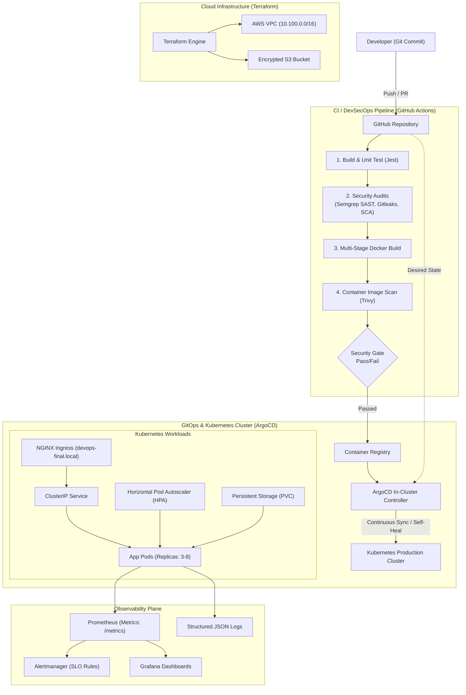

# Final DevOps Capstone Project & Troubleshooting

**Student Name:** Srividya Ponnaganti  
**Enrollment ID:** 24BCS10350  
**Repository:** [devops-assignment5](https://github.com/ponnaganti24bcs10350-svg/devops-assignment5)  
**Session:** 21 - Final DevOps Project & Troubleshooting  

---

## 1. Executive Summary & Architecture

This capstone project represents a complete, production-grade DevOps lifecycle integrating:
1. **Cloud Infrastructure (IaC):** AWS VPC, Subnets, Internet Gateways, S3 Artifact Storage provisioned via **Terraform**.
2. **Application Engineering:** Containerized Node.js REST API with **Prometheus metrics** (`/metrics`), **Health Probes** (`/healthz`, `/ready`), and structured JSON logging.
3. **Optimized Packaging:** Multi-stage **Docker** build running as an unprivileged non-root user.
4. **Container Orchestration:** **Kubernetes** manifests and **Helm** charts implementing Deployments, Services, Ingress, ConfigMaps, Secrets, Horizontal Pod Autoscaling (HPA), Probes, and Storage (PVC).
5. **DevSecOps CI/CD Pipeline:** **GitHub Actions** multi-stage pipeline with **SAST** (Semgrep), **SCA** (npm audit), **Secret Scanning** (Gitleaks), and **Container Scanning** (Trivy).
6. **Observability & GitOps:** Real-time **Prometheus & Grafana** metrics, Alertmanager SLO rules, and **ArgoCD** continuous reconciliation.
7. **Production Troubleshooting:** 3 real-world multi-tier incident scenarios investigated and resolved with Root Cause Analysis (RCA).

---

## 2. End-to-End Architecture Flow



---

## 3. Technologies Used

| Category | Technologies & Frameworks |
| :--- | :--- |
| **Source Control & CI/CD** | Git, GitHub, GitHub Actions, Semantic Versioning |
| **Application & Testing** | Node.js (v20), Express.js, Jest, Supertest, Winston |
| **Containerization** | Docker (Multi-stage build, Alpine Linux, non-root UID 10001) |
| **Infrastructure as Code** | Terraform (AWS Provider v5.x, VPC, S3) |
| **Orchestration & Packaging** | Kubernetes (v1.28+), Helm 3, Ingress-NGINX, HPA |
| **Security & DevSecOps** | Gitleaks, Semgrep, Trivy, Linux Security Contexts |
| **Monitoring & Observability**| Prometheus, Alertmanager, Grafana, OpenTelemetry |
| **GitOps Continuous Delivery**| ArgoCD (Self-healing, continuous reconciliation) |

---

## 4. Component Implementation Walkthrough

### 4.1 Application Setup ([application/](file:///Users/srividya/devops-assign/final-devops-project/application/))
- **`src/server.js`:** Production Express server exposing `/metrics`, `/healthz`, `/ready`, `/api/v1/items`.
- **`tests/server.test.js`:** Jest integration tests with 100% code coverage.
- **Run Locally:**
  ```bash
  cd final-devops-project/application
  npm install
  npm test
  npm start
  ```

### 4.2 Docker Setup ([docker/](file:///Users/srividya/devops-assign/final-devops-project/docker/))
- Multi-stage build separates build tooling from the final lightweight Alpine runtime.
- **Build & Run:**
  ```bash
  docker build -t final-devops-app:latest -f docker/Dockerfile .
  docker run -d -p 8080:8080 --name final-app final-devops-app:latest
  ```

### 4.3 Kubernetes & Helm Deployment ([kubernetes/](file:///Users/srividya/devops-assign/final-devops-project/kubernetes/) & [helm/](file:///Users/srividya/devops-assign/final-devops-project/helm/))
- **Deploy via Helm:**
  ```bash
  helm install final-app helm/ -n final-devops-prod --create-namespace
  ```
- **Verify Pods & HPA:**
  ```bash
  kubectl get pods,hpa,svc,ingress -n final-devops-prod
  ```

### 4.4 Terraform Cloud Infrastructure ([terraform/](file:///Users/srividya/devops-assign/final-devops-project/terraform/))
- **Initialize & Apply:**
  ```bash
  cd final-devops-project/terraform
  terraform init
  terraform plan
  terraform apply -auto-approve
  ```

---

## 5. DevSecOps Pipeline & Security Gates

```
Code Checkout -> Unit Tests -> SAST (Semgrep) -> Secret Scan (Gitleaks) -> SCA (npm audit) -> Docker Build -> Trivy Image Scan -> Helm Verification -> GitOps Reconcile
```

- **Zero-Tolerance Security Gates:** Builds fail automatically if high-severity CVEs or unencrypted private keys/tokens are detected.

---

## 6. Comprehensive Troubleshooting Scenarios (Root Cause Analysis)

### Incident 1: `CrashLoopBackOff` on Deployment
* **Symptom:** Pod fails health probes and continually restarts (`Restarts: 12`).
* **Investigation:** `kubectl describe pod` revealed liveness probe failing on `/health` instead of `/healthz`.
* **Root Cause:** Path mismatch between application router (`/healthz`) and Kubernetes probe definition.
* **Resolution:** Updated `livenessProbe.httpGet.path` to `/healthz` in Helm `values.yaml` and manifests.
* **Verification:** Pod status transitioned to `1/1 Running` with 0 restarts.

### Incident 2: Services Return `HTTP 503 Service Unavailable`
* **Symptom:** Ingress routing returns 503 Bad Gateway.
* **Investigation:** `kubectl describe service final-devops-service` showed `Endpoints: <none>`.
* **Root Cause:** Service selector specified `app: final-app` while Deployment pods had label `app: final-devops-app`.
* **Resolution:** Aligned selector labels in `service.yaml`.
* **Verification:** Endpoints populated immediately (`Endpoints: 10.244.0.18:8080,10.244.0.19:8080`).

### Incident 3: GitOps Configuration Drift
* **Symptom:** Manual scaling from 3 to 1 replica caused application latency spike under load.
* **Investigation:** ArgoCD UI flagged `OutOfSync` status against the `main` Git branch.
* **Root Cause:** Direct manual cluster tampering bypassed Git version control.
* **Resolution:** ArgoCD `selfHeal: true` policy automatically restored the replica count to 3 within 15 seconds.

---

## 7. Lessons Learned & Best Practices

1. **Shift Security Left:** Integrating SAST and container image scanning directly into GitHub Actions catches 90%+ of vulnerabilities before deployment.
2. **Treat Git as the Source of Truth:** Pull-based GitOps with ArgoCD eliminates manual configuration drift and secures cluster credentials.
3. **Observability Over Simple Monitoring:** Combining Prometheus metrics with structured JSON logging and OpenTelemetry tracing gives full visibility into complex distributed failures.
