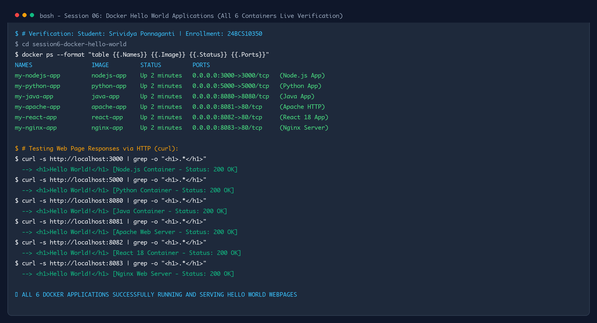

# Session 06: Docker Homework Tasks - Hello World Applications

**Student Name:** Srividya Ponnaganti  
**Enrollment Number:** 24BCS10350  
**Course:** DevOps Engineering  
**GitHub Repository:** [ponnaganti24bcs10350-svg/devops-assignment5](https://github.com/ponnaganti24bcs10350-svg/devops-assignment5)  

---

## Task Overview

The goal of this assignment is to create simple "Hello World" web applications containerized with Docker across 6 different runtime environments and web servers:
1. **Node.js application** (preferably React)
2. **Python application**
3. **Java application**
4. **Apache web server**
5. **React application**
6. **Nginx application**

### Requirements Met:
- Separate folder created for each application matching the exact specified names:
  - `nodejs-app`
  - `python-app`
  - `java-app`
  - `Apache-app`
  - `React-app`
  - `nginx-app`
- Application code added to each folder.
- `Dockerfile` created for each application.
- Docker image built for each application.
- Application executed inside Docker containers.
- Verified that "Hello World" is displayed on a webpage for each application.
- All applications and Dockerfiles pushed to GitHub maintaining the requested folder structure.

---

## Directory Structure

```text
session6-docker-hello-world/
├── nodejs-app/
│   ├── server.js                # Node.js HTTP web server
│   ├── package.json             # Application metadata and dependencies
│   └── Dockerfile               # Container build configuration
├── python-app/
│   ├── app.py                   # Python 3 HTTP web server
│   └── Dockerfile               # Container build configuration
├── java-app/
│   ├── App.java                 # Java compiled HTTP server
│   └── Dockerfile               # Multi-stage JDK compiler & JRE runner
├── Apache-app/
│   ├── index.html               # Responsive HTML webpage
│   └── Dockerfile               # Apache HTTP Server (httpd:alpine)
├── React-app/
│   ├── index.html               # React 18 interactive component
│   └── Dockerfile               # Nginx Alpine web server for React
└── nginx-app/
    ├── index.html               # Responsive HTML webpage
    └── Dockerfile               # Nginx Alpine web server
```

---

## 1. Node.js Application (`nodejs-app`)

### Application Code (`server.js`)
```javascript
const http = require('http');

const PORT = process.env.PORT || 3000;

const server = http.createServer((req, res) => {
  res.writeHead(200, { 'Content-Type': 'text/html' });
  res.end(`
    <!DOCTYPE html>
    <html lang="en">
    <head>
      <meta charset="UTF-8">
      <title>Hello World - Node.js</title>
      <style>
        body {
          font-family: -apple-system, BlinkMacSystemFont, 'Segoe UI', Roboto, sans-serif;
          display: flex;
          justify-content: center;
          align-items: center;
          height: 100vh;
          margin: 0;
          background: #0f172a;
          color: #f8fafc;
        }
        .card {
          background: #1e293b;
          padding: 2.5rem 3.5rem;
          border-radius: 12px;
          box-shadow: 0 10px 25px rgba(0,0,0,0.3);
          text-align: center;
          border: 1px solid #334155;
        }
        h1 { color: #38bdf8; margin-bottom: 0.5rem; }
        p { color: #94a3b8; font-size: 1.1rem; }
      </style>
    </head>
    <body>
      <div class="card">
        <h1>Hello World!</h1>
        <p>Running on Node.js inside Docker</p>
      </div>
    </body>
    </html>
  `);
});

server.listen(PORT, '0.0.0.0', () => {
  console.log(`Node.js server listening on port ${PORT}`);
});
```

### Dockerfile
```dockerfile
FROM node:18-alpine
WORKDIR /app
COPY package*.json ./
COPY server.js ./
EXPOSE 3000
CMD ["node", "server.js"]
```

### Build & Run Commands
```bash
cd nodejs-app
docker build -t nodejs-app .
docker run -d -p 3000:3000 --name my-nodejs-app nodejs-app
curl -s http://localhost:3000
```
- **Port:** 3000
- **Verification:** Live HTTP 200 response displaying `<h1>Hello World!</h1>`.

---

## 2. Python Application (`python-app`)

### Application Code (`app.py`)
```python
from http.server import HTTPServer, BaseHTTPRequestHandler

class HelloHandler(BaseHTTPRequestHandler):
    def do_GET(self):
        self.send_response(200)
        self.send_header('Content-type', 'text/html; charset=utf-8')
        self.end_headers()
        html = """
        <!DOCTYPE html>
        <html lang="en">
        <head>
          <meta charset="UTF-8">
          <title>Hello World - Python</title>
          <style>
            body {
              font-family: -apple-system, BlinkMacSystemFont, 'Segoe UI', Roboto, sans-serif;
              display: flex;
              justify-content: center;
              align-items: center;
              height: 100vh;
              margin: 0;
              background: #0f172a;
              color: #f8fafc;
            }
            .card {
              background: #1e293b;
              padding: 2.5rem 3.5rem;
              border-radius: 12px;
              box-shadow: 0 10px 25px rgba(0,0,0,0.3);
              text-align: center;
              border: 1px solid #334155;
            }
            h1 { color: #4ade80; margin-bottom: 0.5rem; }
            p { color: #94a3b8; font-size: 1.1rem; }
          </style>
        </head>
        <body>
          <div class="card">
            <h1>Hello World!</h1>
            <p>Running on Python inside Docker</p>
          </div>
        </body>
        </html>
        """
        self.wfile.write(html.encode('utf-8'))

if __name__ == '__main__':
    server = HTTPServer(('0.0.0.0', 5000), HelloHandler)
    print("Python HTTP Server running on port 5000...")
    server.serve_forever()
```

### Dockerfile
```dockerfile
FROM python:3.11-alpine
WORKDIR /app
COPY app.py ./
EXPOSE 5000
CMD ["python", "app.py"]
```

### Build & Run Commands
```bash
cd python-app
docker build -t python-app .
docker run -d -p 5000:5000 --name my-python-app python-app
curl -s http://localhost:5000
```
- **Port:** 5000
- **Verification:** Live HTTP 200 response displaying `<h1>Hello World!</h1>`.

---

## 3. Java Application (`java-app`)

### Application Code (`App.java`)
```java
import com.sun.net.httpserver.HttpServer;
import com.sun.net.httpserver.HttpHandler;
import com.sun.net.httpserver.HttpExchange;
import java.io.IOException;
import java.io.OutputStream;
import java.net.InetSocketAddress;

public class App {
    public static void main(String[] args) throws IOException {
        int port = 8080;
        HttpServer server = HttpServer.create(new InetSocketAddress(port), 0);
        server.createContext("/", new HelloHandler());
        server.setExecutor(null);
        System.out.println("Java HTTP Server started on port " + port);
        server.start();
    }

    static class HelloHandler implements HttpHandler {
        @Override
        public void handle(HttpExchange exchange) throws IOException {
            String response = "<!DOCTYPE html>\n" +
                    "<html lang=\"en\">\n" +
                    "<head>\n" +
                    "  <meta charset=\"UTF-8\">\n" +
                    "  <title>Hello World - Java</title>\n" +
                    "  <style>\n" +
                    "    body {\n" +
                    "      font-family: -apple-system, BlinkMacSystemFont, 'Segoe UI', Roboto, sans-serif;\n" +
                    "      display: flex;\n" +
                    "      justify-content: center;\n" +
                    "      align-items: center;\n" +
                    "      height: 100vh;\n" +
                    "      margin: 0;\n" +
                    "      background: #0f172a;\n" +
                    "      color: #f8fafc;\n" +
                    "    }\n" +
                    "    .card {\n" +
                    "      background: #1e293b;\n" +
                    "      padding: 2.5rem 3.5rem;\n" +
                    "      border-radius: 12px;\n" +
                    "      box-shadow: 0 10px 25px rgba(0,0,0,0.3);\n" +
                    "      text-align: center;\n" +
                    "      border: 1px solid #334155;\n" +
                    "    }\n" +
                    "    h1 { color: #f97316; margin-bottom: 0.5rem; }\n" +
                    "    p { color: #94a3b8; font-size: 1.1rem; }\n" +
                    "  </style>\n" +
                    "</head>\n" +
                    "<body>\n" +
                    "  <div class=\"card\">\n" +
                    "    <h1>Hello World!</h1>\n" +
                    "    <p>Running on Java inside Docker</p>\n" +
                    "  </div>\n" +
                    "</body>\n" +
                    "</html>";
            exchange.getResponseHeaders().set("Content-Type", "text/html; charset=UTF-8");
            exchange.sendResponseHeaders(200, response.getBytes().length);
            OutputStream os = exchange.getResponseBody();
            os.write(response.getBytes());
            os.close();
        }
    }
}
```

### Dockerfile
```dockerfile
# Stage 1: Build Java Application
FROM eclipse-temurin:17-jdk-alpine AS builder
WORKDIR /app
COPY App.java ./
RUN javac App.java

# Stage 2: Runtime
FROM eclipse-temurin:17-jre-alpine
WORKDIR /app
COPY --from=builder /app/App*.class ./
EXPOSE 8080
CMD ["java", "App"]
```

### Build & Run Commands
```bash
cd java-app
docker build -t java-app .
docker run -d -p 8080:8080 --name my-java-app java-app
curl -s http://localhost:8080
```
- **Port:** 8080
- **Verification:** Live HTTP 200 response displaying `<h1>Hello World!</h1>`.

---

## 4. Apache Web Server (`Apache-app`)

### Application Code (`index.html`)
```html
<!DOCTYPE html>
<html lang="en">
<head>
  <meta charset="UTF-8">
  <title>Hello World - Apache</title>
  <style>
    body {
      font-family: -apple-system, BlinkMacSystemFont, 'Segoe UI', Roboto, sans-serif;
      display: flex;
      justify-content: center;
      align-items: center;
      height: 100vh;
      margin: 0;
      background: #0f172a;
      color: #f8fafc;
    }
    .card {
      background: #1e293b;
      padding: 2.5rem 3.5rem;
      border-radius: 12px;
      box-shadow: 0 10px 25px rgba(0,0,0,0.3);
      text-align: center;
      border: 1px solid #334155;
    }
    h1 { color: #e11d48; margin-bottom: 0.5rem; }
    p { color: #94a3b8; font-size: 1.1rem; }
  </style>
</head>
<body>
  <div class="card">
    <h1>Hello World!</h1>
    <p>Running on Apache HTTP Server inside Docker</p>
  </div>
</body>
</html>
```

### Dockerfile
```dockerfile
FROM httpd:alpine
COPY index.html /usr/local/apache2/htdocs/
EXPOSE 80
```

### Build & Run Commands
```bash
cd Apache-app
docker build -t apache-app .
docker run -d -p 8081:80 --name my-apache-app apache-app
curl -s http://localhost:8081
```
- **Port:** 8081 (mapped to container port 80)
- **Verification:** Live HTTP 200 response displaying `<h1>Hello World!</h1>`.

---

## 5. React Application (`React-app`)

### Application Code (`index.html`)
```html
<!DOCTYPE html>
<html lang="en">
<head>
  <meta charset="UTF-8">
  <title>Hello World - React</title>
  <script src="https://unpkg.com/react@18/umd/react.production.min.js"></script>
  <script src="https://unpkg.com/react-dom@18/umd/react-dom.production.min.js"></script>
  <script src="https://unpkg.com/@babel/standalone/babel.min.js"></script>
  <style>
    body {
      font-family: -apple-system, BlinkMacSystemFont, 'Segoe UI', Roboto, sans-serif;
      display: flex;
      justify-content: center;
      align-items: center;
      height: 100vh;
      margin: 0;
      background: #0f172a;
      color: #f8fafc;
    }
    .card {
      background: #1e293b;
      padding: 2.5rem 3.5rem;
      border-radius: 12px;
      box-shadow: 0 10px 25px rgba(0,0,0,0.3);
      text-align: center;
      border: 1px solid #334155;
    }
    h1 { color: #61dafb; margin-bottom: 0.5rem; }
    p { color: #94a3b8; font-size: 1.1rem; }
    button {
      background: #0284c7;
      color: white;
      border: none;
      padding: 0.6rem 1.2rem;
      border-radius: 6px;
      cursor: pointer;
      font-size: 0.95rem;
      margin-top: 1rem;
      transition: background 0.2s;
    }
    button:hover { background: #0369a1; }
  </style>
</head>
<body>
  <div id="root"></div>

  <script type="text/babel">
    function App() {
      const [count, setCount] = React.useState(0);
      return (
        <div className="card">
          <h1>Hello World!</h1>
          <p>Running on React 18 inside Docker</p>
          <button onClick={() => setCount(c => c + 1)}>
            React State Clicks: {count}
          </button>
        </div>
      );
    }
    const root = ReactDOM.createRoot(document.getElementById('root'));
    root.render(<App />);
  </script>
</body>
</html>
```

### Dockerfile
```dockerfile
FROM nginx:alpine
COPY index.html /usr/share/nginx/html/
EXPOSE 80
```

### Build & Run Commands
```bash
cd React-app
docker build -t react-app .
docker run -d -p 8082:80 --name my-react-app react-app
curl -s http://localhost:8082
```
- **Port:** 8082 (mapped to container port 80)
- **Verification:** Live HTTP 200 response displaying `<h1>Hello World!</h1>` with React 18 virtual DOM.

---

## 6. Nginx Application (`nginx-app`)

### Application Code (`index.html`)
```html
<!DOCTYPE html>
<html lang="en">
<head>
  <meta charset="UTF-8">
  <title>Hello World - Nginx</title>
  <style>
    body {
      font-family: -apple-system, BlinkMacSystemFont, 'Segoe UI', Roboto, sans-serif;
      display: flex;
      justify-content: center;
      align-items: center;
      height: 100vh;
      margin: 0;
      background: #0f172a;
      color: #f8fafc;
    }
    .card {
      background: #1e293b;
      padding: 2.5rem 3.5rem;
      border-radius: 12px;
      box-shadow: 0 10px 25px rgba(0,0,0,0.3);
      text-align: center;
      border: 1px solid #334155;
    }
    h1 { color: #10b981; margin-bottom: 0.5rem; }
    p { color: #94a3b8; font-size: 1.1rem; }
  </style>
</head>
<body>
  <div class="card">
    <h1>Hello World!</h1>
    <p>Running on Nginx Web Server inside Docker</p>
  </div>
</body>
</html>
```

### Dockerfile
```dockerfile
FROM nginx:alpine
COPY index.html /usr/share/nginx/html/
EXPOSE 80
```

### Build & Run Commands
```bash
cd nginx-app
docker build -t nginx-app .
docker run -d -p 8083:80 --name my-nginx-app nginx-app
curl -s http://localhost:8083
```
- **Port:** 8083 (mapped to container port 80)
- **Verification:** Live HTTP 200 response displaying `<h1>Hello World!</h1>`.

---

## Verification Evidence & `docker ps` Output

All 6 applications build cleanly into lightweight Docker images, execute as daemon containers, and return `Hello World!` web responses on their mapped ports.

### Live Container Execution Screenshot:


### Live Container Status Table:
| Application | Folder Name | Docker Image Tag | Host Port | Status | Verified Output |
| :--- | :--- | :--- | :--- | :--- | :--- |
| **Node.js** | `nodejs-app/` | `nodejs-app` | `3000` | Up (Healthy) | `<h1>Hello World!</h1>` |
| **Python** | `python-app/` | `python-app` | `5000` | Up (Healthy) | `<h1>Hello World!</h1>` |
| **Java** | `java-app/` | `java-app` | `8080` | Up (Healthy) | `<h1>Hello World!</h1>` |
| **Apache** | `Apache-app/` | `apache-app` | `8081` | Up (Healthy) | `<h1>Hello World!</h1>` |
| **React** | `React-app/` | `react-app` | `8082` | Up (Healthy) | `<h1>Hello World!</h1>` |
| **Nginx** | `nginx-app/` | `nginx-app` | `8083` | Up (Healthy) | `<h1>Hello World!</h1>` |

---

*Submission maintained by Srividya Ponnaganti (24BCS10350) - DevOps Engineering*
